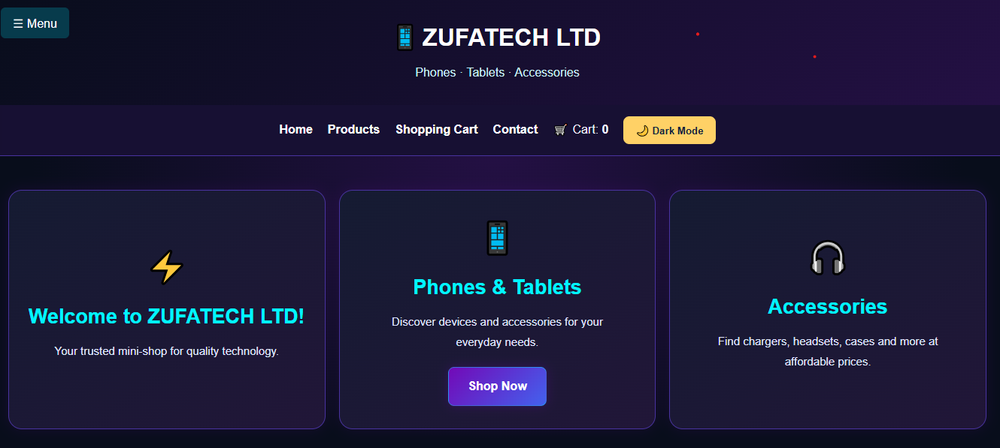
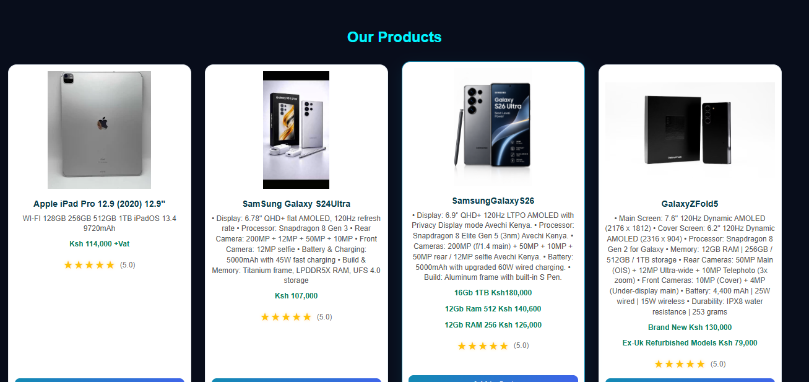
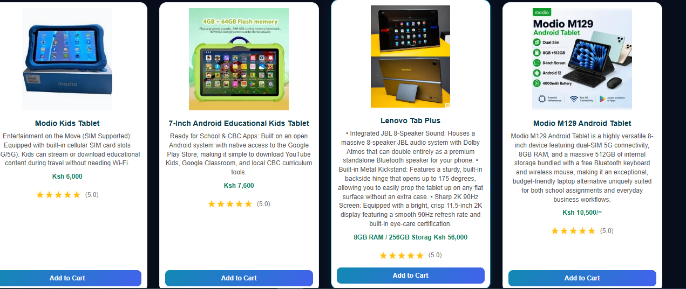
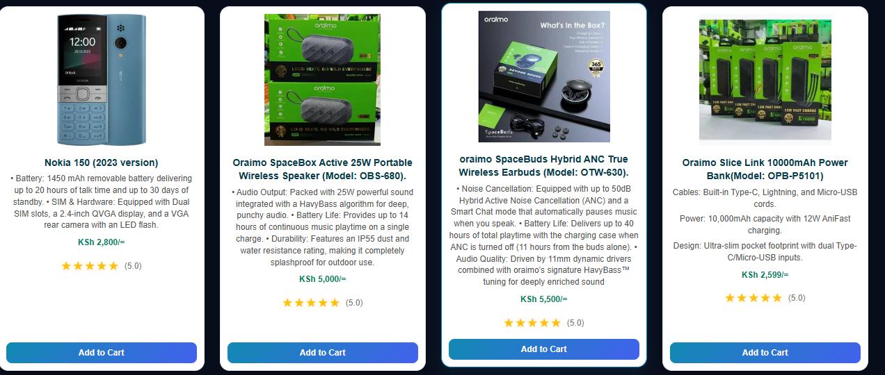
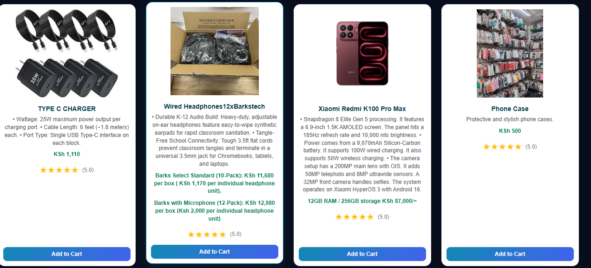
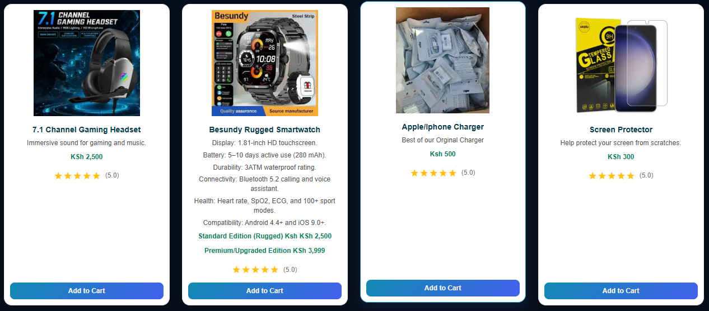
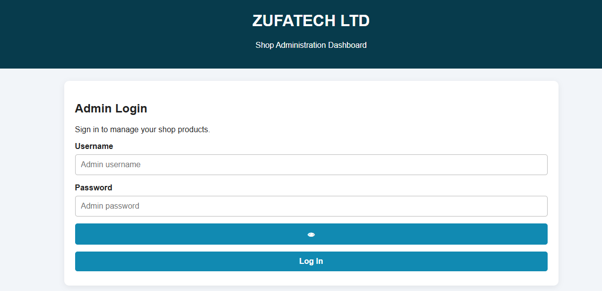
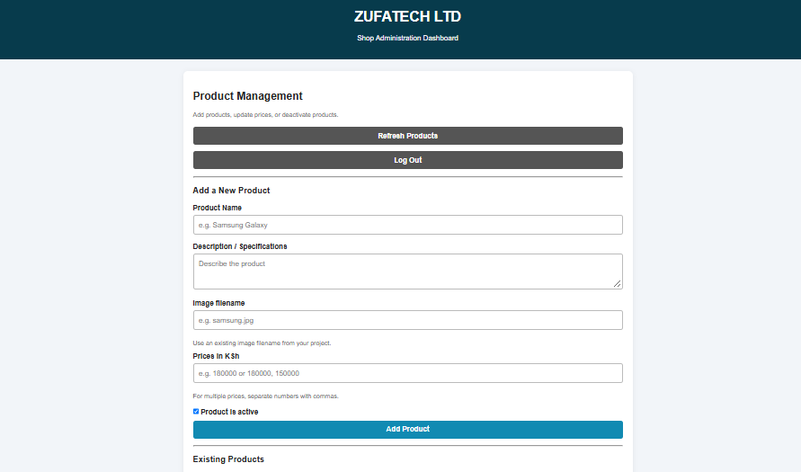

# ZUFATECH LTD Mini-Shop
An online shopping platform for phones, tablets and phone accessories.
## About ZUFATECH LTD

ZUFATECH LTD is an online shop that provides customers with a convenient way to browse phones, tablets and phone accessories.

The website allows customers to view available products, check prices, read product specifications and add items to their shopping cart. Customers can also submit orders through the website.

The shop includes an administration dashboard for managing products, updating prices and controlling product availability.

## Technologies Used

The website is built using the following technologies:

- **HTML5** – Creates the structure of the website.
- **CSS3** – Handles the design, colours and layout.
- **JavaScript** – Controls website interactions and shopping cart functions.
- **Python (Flask)** – Runs the backend and handles API requests.
- **SQLite** – Stores product and order information.
- **JSON** – Supports data storage and exchange.

## Project Structure

The project is organised into two main folders:

- **landing/** – Contains the website pages, styling and frontend JavaScript.
- **backend/** – Contains the Flask application and backend files.

Main files:

- `Index.html` – Main shop homepage.
- `style.css` – Website styling.
- `script.js` – Frontend functionality.
- `Admin.html` – Administrator dashboard.
- `Admin.js` – Admin dashboard functionality.
- `app.py` – Flask backend application.
- `shop.db` – Shop database.
- `check_db.py` – Checks the SQLite database and confirms that the required database tables exist.

### Backend Data Files

- `products.json` – Stores product information used by the shop.
- `orders.json` – Stores order information.
- `shop.db` – SQLite database containing shop records, including products and orders.
- `.env` – Stores private configuration settings such as administrator credentials and the Flask secret key.
### Database Checking

The `check_db.py` file is used to check whether the shop database is accessible and whether the required tables have been created successfully.

### Frontend Folder

The `frontend/` folder is currently empty and reserved for future development.

The active customer-facing website is located in the `landing/` folder.


## How to Run the Website

### 1. Start the Backend

Open Visual Studio Code and open the terminal.

Navigate to the backend folder:

```powershell
cd "C:\Users\Administrator\Desktop\ZUFATECH LTD\mini-shop\backend"

```

Install the required packages:

python -m pip install flask python-dotenv

Start the Flask server:
python app.py

Open the Frontend
Open the browser and visit:

http://127.0.0.1:5000

### 3. Open the Admin Dashboard

Make sure the Flask backend is running.

Open your browser and visit:

http://127.0.0.1:5000/Admin.html

The administrator login page will appear.

Log in using the administrator credentials configured in the backend `.env` file.

## Website Screenshots

The screenshots below show the different sections and features of the ZUFATECH LTD Mini-Shop.

Click any screenshot to view the full-size image.



### Products – Screenshot 1

[](screenshots/products-1.png)

### Products – Screenshot 2

[](screenshots/products-2.png)

### Products – Screenshot 3

[](screenshots/products-3.png)

### Products – Screenshot 4

[](screenshots/products-4.png)

### Products – Screenshot 5

[](screenshots/products-5.png)

### Shopping Cart

The screenshot below shows the shopping cart with selected products and the order total.

[](screenshots/shopping-cart.png)


### Admin Login

The screenshot below shows the administrator login page.

[](screenshots/admin-login.png)


### Admin Dashboard – Product Management

The screenshot below shows the administrator dashboard, including the product management and Add Product sections.

[](screenshots/admin-dashboard.png)

## Conclusion

ZUFATECH LTD aims to provide a convenient and reliable online shopping experience for customers looking for phones, tablets and accessories.

The platform brings together product browsing, shopping cart functionality and product management in one place.

The platform also offers room for future improvements and expansion as customer needs evolve.


